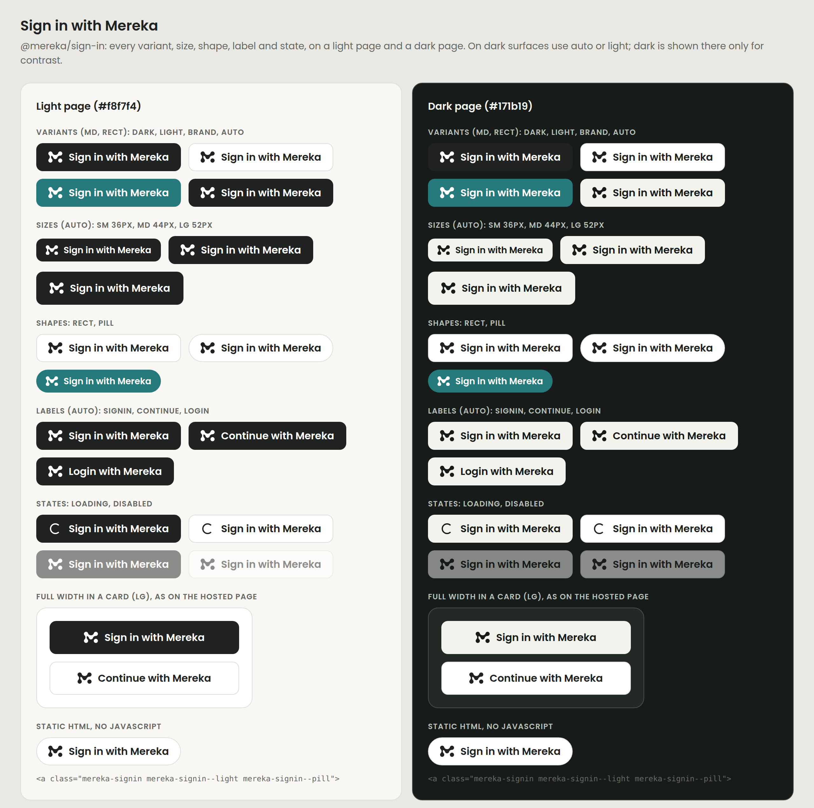

# Sign in with Mereka

`@mereka/sign-in` is the one standard button that sends users to the Mereka hosted sign-in page
(`https://auth0.mereka.io`). Like the Apple and Google buttons, it looks the same in every app, and
apps choose only from a few approved options.

The kit only draws the button. Your app keeps its own auth call: a `href`, a `type="submit"` inside
your form, or an `onClick`.



| File | Use it for |
|---|---|
| `sign-in-with-mereka.css` | The styles. Every other web entry point needs it. |
| `sign-in-with-mereka.js` | `<mereka-signin>` custom element for plain HTML, Django, Angular and other non-React pages |
| `react/` | `<SignInWithMereka>` and `<SignInWithMerekaSubmit>` for React and Next.js |
| `react-native/` | `<SignInWithMereka>` for Expo / React Native |
| `openedx/_mereka-signin.scss` | Styles the Open edX authn MFE's existing SSO button |
| `mark.svg`, `mark.ts` | The logomark, generated from `brands/mereka/logos/svg/mereka-logomark-black.svg` |
| `registry/*.json` | shadcn registry items |
| `preview.html` | Every option on a light and a dark page |

## Get it

The repository is public, so you don't need a registry login. Always pin a tag.

```
https://cdn.jsdelivr.net/gh/Biji-Biji-Initiative/bbbi-mereka-brand-assets@sign-in-v0.1.1/packages/sign-in/sign-in-with-mereka.css
https://cdn.jsdelivr.net/gh/Biji-Biji-Initiative/bbbi-mereka-brand-assets@sign-in-v0.1.1/packages/sign-in/sign-in-with-mereka.js
https://cdn.jsdelivr.net/gh/Biji-Biji-Initiative/bbbi-mereka-brand-assets@sign-in-v0.1.1/packages/sign-in/registry/sign-in-with-mereka.json
https://cdn.jsdelivr.net/gh/Biji-Biji-Initiative/bbbi-mereka-brand-assets@sign-in-v0.1.1/packages/sign-in/registry/sign-in-with-mereka-native.json
```

React apps copy the component in with shadcn. Each copied file begins with a version comment.

```sh
npx shadcn@latest add https://cdn.jsdelivr.net/gh/Biji-Biji-Initiative/bbbi-mereka-brand-assets@sign-in-v0.1.1/packages/sign-in/registry/sign-in-with-mereka.json
# Expo / React Native
npx shadcn@latest add https://cdn.jsdelivr.net/gh/Biji-Biji-Initiative/bbbi-mereka-brand-assets@sign-in-v0.1.1/packages/sign-in/registry/sign-in-with-mereka-native.json
```

The files land in `components/mereka/`: `sign-in-with-mereka.tsx`, `sign-in-with-mereka-submit.tsx`
and `sign-in-with-mereka.css`. The component has no Tailwind or other dependencies, and it imports
its CSS itself. `package.json` describes `@mereka/sign-in@0.1.1` so the kit can be published later.
It is not published to any registry yet.

## 30-second quick starts

### Next.js + next-auth v5 (server action)

```tsx
// app/sign-in/page.tsx: posts without JavaScript and shows the spinner while pending
import { signIn } from "@/auth";
import { SignInWithMerekaSubmit } from "@/components/mereka/sign-in-with-mereka-submit";

export default function SignInPage() {
  return (
    <form
      action={async () => {
        "use server";
        await signIn("authentik", { redirectTo: "/" });
      }}
    >
      <SignInWithMerekaSubmit size="lg" fullWidth />
    </form>
  );
}
```

Leave the provider id as `"authentik"`. Only the visible text has to say Mereka.

### Next.js + Better Auth

```tsx
"use client";
import { useState } from "react";
import { authClient } from "@/lib/auth-client";
import { SignInWithMereka } from "@/components/mereka/sign-in-with-mereka";

export function MerekaSignIn() {
  const [loading, setLoading] = useState(false);
  return (
    <SignInWithMereka
      fullWidth
      loading={loading}
      onClick={async () => {
        setLoading(true);
        await authClient.signIn.social({ provider: "mereka", callbackURL: "/" }); // your provider id
      }}
    />
  );
}
```

If you already have a server action, as explorers.mereka.io does, use
`<form action={signInWithMereka}><SignInWithMerekaSubmit /></form>`.

### Cal.com (next-auth v4, React 18)

`useFormStatus` needs React 19, so use the plain button here:

```tsx
<SignInWithMereka fullWidth loading={loading} onClick={() => { setLoading(true); signIn("authentik"); }} />
```

### Angular

Add the CSS and the element script to `angular.json` (under `styles` and `scripts`), or use the jsDelivr
links. Then allow custom elements in the component:

```ts
@Component({ /* ... */ schemas: [CUSTOM_ELEMENTS_SCHEMA] })
```

```html
<!-- The backend builds the authorize URL -->
<mereka-signin [attr.href]="authorizeUrl" size="lg" width="full"></mereka-signin>
<!-- or keep your click handler -->
<mereka-signin type="button" size="lg" width="full" (click)="signIn()" [attr.loading]="busy ? '' : null"></mereka-signin>
```

### Django templates / plain HTML

```html
<link rel="stylesheet" href="https://cdn.jsdelivr.net/gh/Biji-Biji-Initiative/bbbi-mereka-brand-assets@sign-in-v0.1.1/packages/sign-in/sign-in-with-mereka.css">
<script defer src="https://cdn.jsdelivr.net/gh/Biji-Biji-Initiative/bbbi-mereka-brand-assets@sign-in-v0.1.1/packages/sign-in/sign-in-with-mereka.js"></script>

<!-- A link (GET). The inner <a> still works if the script never loads. -->
<mereka-signin size="lg" width="full"><a href="">Sign in with Mereka</a></mereka-signin>

<!-- A POST form -->
<form method="post" action="">
  
  <mereka-signin size="lg" width="full"><button type="submit">Sign in with Mereka</button></mereka-signin>
</form>
```

The element styles the `<a>` or `<button>` you put inside it. Without a child, it creates one: an `<a>`
when it has `href`, otherwise a `<button>` (`type` defaults to `button`). It shows the spinner while the
browser leaves for the sign-in page. Add `no-auto-loading` to turn that off.

To skip the script entirely, copy the static markup from `preview.html`:
`<a class="mereka-signin" href="…"><span class="mereka-signin__icon" aria-hidden="true">…mark.svg…</span><span class="mereka-signin__label">Sign in with Mereka</span></a>`.

### Expo / React Native

Install `react-native-svg` first with `npx expo install react-native-svg`. That picks the version that
matches your Expo SDK, so the registry item doesn't install it for you.

```tsx
import { SignInWithMereka } from "@/components/mereka/sign-in-with-mereka";

<SignInWithMereka size="lg" fullWidth loading={busy} onPress={() => signInWithMereka()} />
```

It uses `Pressable` with `accessibilityRole="button"`. The accessibility label is the visible text, and
the accessibility state reports busy and disabled. `variant="auto"` follows `useColorScheme()`. To theme
it, pass `colors={{ bg, fg, border, pressed }}` and `fontFamily`.

### Open edX authn MFE (SCSS only)

The MFE draws its own `.btn-oa2-authentik` / `.btn-oidc` button, and its icon slot is empty. Vendor the
snippet into the theme and import it after the auth styles:

```scss
// $mereka-signin-bg: #ffffff; $mereka-signin-fg: #202321; $mereka-signin-border: #dcded8; // light variant
@import "mereka-signin";
```

The snippet puts the mark in the icon slot as a CSS mask, so the mark takes the text colour. It also
matches the kit's colours, radius and 52px height. The MFE writes "Continue with " in front of the
provider name "Mereka", which gives "Continue with Mereka", an accepted label. The snippet leaves that
text alone. To change which buttons it styles, set `$mereka-signin-selectors`.

## Options

| Option | Values | Default |
|---|---|---|
| variant | `dark` (ink fill, matches the hosted page's primary button), `light` (white, ink text, `#dcded8` border), `brand` (Mereka teal), `auto` (ink, inverted on dark pages) | `dark` |
| size | `sm` 36px, `md` 44px (minimum tap target), `lg` 52px (= 3.25rem, as on the hosted page) | `md` |
| shape | `rect` (.65rem radius, as on the hosted page), `pill` | `rect` |
| label | `signin` "Sign in with Mereka", `continue` "Continue with Mereka", `login` "Login with Mereka" | `signin` |
| full width | React `fullWidth`, element `width="full"`, class `mereka-signin--full` | off |
| loading / disabled | React `loading` / `disabled`, element `loading` / `disabled` attributes | off |

CSS classes: `mereka-signin` plus one modifier from each group: `mereka-signin--dark`,
`mereka-signin--light`, `mereka-signin--brand`, `mereka-signin--auto`, `mereka-signin--sm`,
`mereka-signin--md`, `mereka-signin--lg`, `mereka-signin--rect`, `mereka-signin--pill`, and optionally
`mereka-signin--full`. Inside the button go `mereka-signin__icon` (which holds `mereka-signin__mark`) and
`mereka-signin__label`. Loading is `aria-busy="true"`; disabled is `:disabled` or `aria-disabled="true"`.

`--auto` inverts when an ancestor has `.dark` or `[data-theme="dark"]`, or when the OS is in dark mode
and the root does not have `.light` or `[data-theme="light"]`. On a dark surface, use `--light` or `--auto`
rather than `--dark`.

`--brand` uses `#267a7c`, a slightly deeper Mereka teal. White 16px text on the palette teal `#2d898b`
has a contrast of 4.1:1, which fails WCAG AA. On `#267a7c` it is 5:1.

### Labels

The policy is `sso_display_policy` in bbi-infrastructure `docs/AUTH_REGISTRY.yaml`. The canonical text is
**Sign in with Mereka**. The policy also accepts "Continue with Mereka" and "Login with Mereka".

Free text (`labelText` in React, `label-text` on the element) works, but avoid it. It exists for
translations. Text that names Authentik is refused: the button shows "Sign in with Mereka" and logs a
console warning.

"Sign up with Mereka" is a possible sign-up label, but it is **not** in the accepted list yet. Add it to
`accepted_button_text` in `AUTH_REGISTRY.yaml` before using it. Until then the kit doesn't offer it.

## Theming

Set any of these on the button or on an ancestor. You don't need to fork the kit:

| Property | Controls |
|---|---|
| `--mereka-signin-bg` | Fill (hover is derived from it) |
| `--mereka-signin-fg` | Text and mark colour |
| `--mereka-signin-border` | Border (defaults to the fill; `#dcded8` for light) |
| `--mereka-signin-radius` | Corner radius |
| `--mereka-signin-font` | Font family (default: Poppins if loaded, then the system stack) |
| `--mereka-signin-ring` | Focus ring colour |
| `--mereka-signin-height` | Minimum height |
| `--mereka-signin-font-size` | Text size |
| `--mereka-signin-mark-size` | Mark height (default 1.1em) |

```css
.my-auth-card { --mereka-signin-radius: 999px; --mereka-signin-font: "Lato", sans-serif; }
```

A property set on an ancestor applies to every Mereka button inside it, whatever its variant.

## Do and don't

- **Do** send users to the hosted page with this button and one of the three accepted labels.
- **Do** keep the mark on the left and in the same colour as the text. The kit handles this.
- **Do** keep at least `md` (44px) where people tap. Use `sm` only in dense desktop toolbars.
- **Don't** write "Authentik" in anything users see. "Sign in with Authentik" breaks the policy.
  Provider ids such as `signIn("authentik")` are internal and fine.
- **Don't** recolour, stretch, outline or replace the mark. Don't put it on a colour it can't be seen on.
- **Don't** fork the CSS or copy the mark's SVG into apps. Theme with the custom properties, and update
  by moving to a newer tag.
- **Don't** put other words in the button ("Sign in with Mereka SSO", "Mereka account login").

## Upgrades

- Pin a tag (`@sign-in-vX.Y.Z`) everywhere: CDN links, shadcn URLs, vendored SCSS. Never pin `@main`.
- Patch releases (0.1.x) change only visuals or fixes and keep the same markup and options.
  Minor releases may add options. Breaking changes get a new minor version while the kit is at 0.x, and
  are listed in the release notes for the tag.
- Re-run `npx shadcn@latest add <url@new-tag>` to update copied components. The version comment at the
  top of each file shows which tag it came from.

## Adoption

None of these apps use the kit yet. The first three are the first adoptions because each one is broken
or breaks the label policy today.

| # | App | Current implementation | Switch to |
|---|---|---|---|
| 1 | mereka-support | `src/app/login/page.tsx` says "Sign in with Authentik" (**breaks the policy**) | React `SignInWithMerekaSubmit` inside its existing `signIn("authentik")` server-action form |
| 2 | mereka-cal | `apps/web/modules/auth/login-view.tsx` shows `t("signin_with_authentik")` = "Sign in with Authentik" (**breaks the policy**); also `mereka-view.tsx` | React `SignInWithMereka` with `onClick={() => signIn("authentik")}` (next-auth v4, React 18), and fix the locale string |
| 3 | team-analytics invite form | `apps/dashboard/src/app/invite/[token]/invite-accept-form.tsx` POSTs to `/api/auth/signin/authentik` with no CSRF token, so next-auth likely rejects it (**likely broken**) | A server action that calls `signIn("authentik", { redirectTo })` with `SignInWithMerekaSubmit` |
| 4 | team-analytics sign-in | `apps/dashboard/src/app/auth/sign-in/sign-in-content.tsx` + `mereka-logo.tsx` (copy of the mark) | `SignInWithMerekaSubmit`; delete `mereka-logo.tsx` |
| 5 | explorers.mereka.io | `src/components/auth/sign-in-button.tsx` + `mereka-mark.tsx` (lime pill, the model for this kit) | `SignInWithMerekaSubmit` in the existing `signInWithMereka` form; delete `mereka-mark.tsx` |
| 6 | reka admin | `src/app/admin/sign-in/sign-in.tsx` (Better Auth) | React `SignInWithMereka` / `SignInWithMerekaSubmit` |
| 7 | mereka-agent-e login | `frontend/src/app/login/page.tsx` + `actions.ts` (`beginSignIn`, next-auth v5) | `SignInWithMerekaSubmit` in the `beginSignIn` form |
| 8 | zoom-rtms dashboard | `dashboard/src/app/login/login-client.tsx` + `sso-sign-in.ts` | `SignInWithMereka` / `SignInWithMerekaSubmit` |
| 9 | mereka-lms-proofboard | `app/auth/sign-in/page.tsx` | `SignInWithMerekaSubmit` |
| 10 | explorers-app (Expo) | `src/app/welcome.tsx`, `src/lib/auth.ts` | React Native `SignInWithMereka` |
| 11 | mereka-cards (Expo) | `apps/mobile/src/features/auth/brand-mark.tsx` (copy of the mark, tested against the asset) | React Native `SignInWithMereka`, or point the brand-mark test at `@mereka/sign-in/mark` |
| 12 | mereka-frontend-workspace-v2 | `projects/auth/.../auth-body/auth-body.component.ts` (backend builds the authorize URL) | `<mereka-signin [attr.href]="authorizeUrl">` with `CUSTOM_ELEMENTS_SCHEMA` |
| 13 | mereka-lms authn MFE | `.btn-oa2-authentik` / `.btn-oa2-oidc` in `infrastructure/tutor/themes/mereka/mfe/scss/_auth.scss` (icon slot empty) | Vendor `openedx/_mereka-signin.scss` and import it after `_auth.scss` |

## Develop

```sh
node packages/sign-in/scripts/build.mjs   # regenerate mark.svg, mark.ts, the embedded marks and registry/*.json
node packages/sign-in/scripts/check.mjs   # mark drift, label policy, documented classes, version stamps
```

The canonical logomark, `brands/mereka/logos/svg/mereka-logomark-black.svg`, is the only source of the
mark. Don't edit the `<sign-in:generated>` blocks by hand. To release, bump `version` in `package.json`,
run the build and the check, commit, then push an annotated `sign-in-vX.Y.Z` tag.
